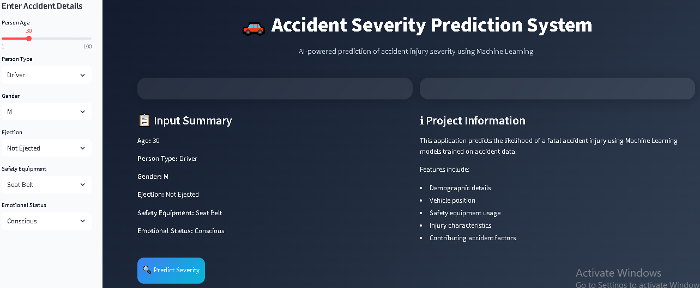
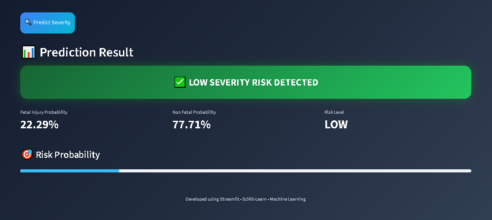

# 🚗 Accident Severity Prediction Using Machine Learning


---

## 📌 Project Overview

Accident Severity Prediction is a Machine Learning project developed to predict the severity of road accidents based on accident-related and personal characteristics.

The system analyzes multiple factors such as:

- 👤 Person Type
- 🎂 Age
- 🚻 Gender
- 🦺 Safety Equipment
- 🚗 Ejection Status
- 😟 Emotional Status
- ⚠️ Contributing Accident Factors

and predicts whether the accident is likely to result in:

✅ **Low Severity Injury**

or

⚠️ **High Severity / Fatal Injury**

The project combines Data Analysis, Machine Learning, Model Evaluation, and Streamlit Deployment into a complete end-to-end solution.

---

# 🎯 Objectives

✔ Analyze accident records

✔ Perform data preprocessing and cleaning

✔ Handle missing values

✔ Build and compare machine learning models

✔ Perform model validation

✔ Optimize model performance

✔ Identify important accident-related factors

✔ Deploy the model using Streamlit

---

# 📂 Dataset Information

### Dataset Features

| Feature | Description |
|----------|------------|
| PERSON_TYPE | Driver / Passenger / Pedestrian |
| PERSON_AGE | Age of Person |
| PERSON_SEX | Gender |
| EJECTION | Ejection Status |
| EMOTIONAL_STATUS | Emotional Condition |
| SAFETY_EQUIPMENT | Safety Equipment Used |
| CONTRIBUTING_FACTOR_1 | Primary Cause of Accident |
| CONTRIBUTING_FACTOR_2 | Secondary Cause |
| PERSON_INJURY | Target Variable |

---

# 🛠 Data Preprocessing

The following preprocessing steps were performed:

✅ Missing Value Analysis

✅ Duplicate Record Verification

✅ Feature Selection

✅ Categorical Encoding

✅ Train-Test Splitting

✅ Pipeline-Based Transformation

### Preprocessing Workflow

```text
Raw Dataset
      ↓
Data Cleaning
      ↓
Missing Value Handling
      ↓
Feature Selection
      ↓
Encoding
      ↓
Train-Test Split
      ↓
Machine Learning Pipeline
```

---

# 📊 Exploratory Data Analysis (EDA)

Several analyses were performed to understand the accident data:

📈 Injury Distribution

📈 Age Distribution

📈 Gender Distribution

📈 Contributing Factors Analysis

📈 Correlation Heatmap

### Key Insights

- Most accident victims belong to active age groups.
- Safety equipment usage significantly affects injury severity.
- Accident contributing factors influence fatality risk.
- Dataset is highly imbalanced and requires careful evaluation.

---

# 🤖 Machine Learning Models

The following classification algorithms were evaluated:

### 1️⃣ Logistic Regression

- Baseline Classification Model
- Fast and Interpretable

### 2️⃣ Decision Tree Classifier

- Captures Non-Linear Relationships
- Easy to Visualize

### 3️⃣ Random Forest Classifier ⭐

- Ensemble Learning Technique
- Better Generalization
- Reduced Overfitting
- Best Performing Model

---

# 🔍 Model Validation

To improve model reliability:

✅ Stratified Train-Test Split

✅ Cross Validation

✅ Hyperparameter Tuning

### Evaluation Metrics

- Accuracy
- Precision
- Recall
- F1 Score

---

# ⚙ Hyperparameter Tuning

Model optimization was performed using:

### RandomizedSearchCV

Optimized Parameters:

- n_estimators
- max_depth
- min_samples_split
- min_samples_leaf

This helped improve overall model performance and robustness.

---

# 🏆 Final Model

### Selected Model

🥇 **Random Forest Classifier**

### Why Random Forest?

✔ High Prediction Accuracy

✔ Handles Complex Relationships

✔ Reduced Overfitting

✔ Supports Feature Importance Analysis

✔ Suitable for Real-Time Deployment

---

# 🔍 Feature Importance

The model identifies the most influential factors contributing to accident severity.

Important features include:

- 🦺 Safety Equipment
- 🚗 Ejection Status
- 🎂 Person Age
- 😟 Emotional Status
- ⚠️ Contributing Factors

This improves model interpretability and decision-making.

---

# 💻 Streamlit Web Application

An interactive Streamlit application was developed for real-time accident severity prediction.

### Features

✅ User-Friendly Interface

✅ Real-Time Prediction

✅ Probability Score Visualization

✅ Interactive Dashboard

✅ Risk Assessment

---

# 📸 Application Screenshots

## 🏠 Home Page



---

## 📊 Prediction Result



---

# 🏗 Project Architecture

```text
Dataset
   ↓
Data Preprocessing
   ↓
Exploratory Data Analysis
   ↓
Feature Engineering
   ↓
Train-Test Split
   ↓
Cross Validation
   ↓
Hyperparameter Tuning
   ↓
Random Forest Model
   ↓
Model Serialization
   ↓
Streamlit Deployment
   ↓
Accident Severity Prediction
```

---

# 🧰 Technologies Used

| Technology | Purpose |
|------------|----------|
| Python | Programming Language |
| Pandas | Data Analysis |
| NumPy | Numerical Computing |
| Matplotlib | Visualization |
| Seaborn | Data Visualization |
| Scikit-Learn | Machine Learning |
| Joblib | Model Persistence |
| Streamlit | Web Application |

---

# 📁 Project Structure

```text
Accident-Severity-Prediction/
│
├── notebooks/
│   ├── 01_EDA_Preprocessing.ipynb
│   ├── 02_Model_Training.ipynb
│   └── 03_Model_Evaluation.ipynb
│
├── models/
│   └── accident_severity_pipeline.pkl
│
├── screenshots/
│   ├── home2.png
│   └── pre.png
│
├── app.py
├── requirements.txt
├── README.md
└── .gitignore
```

---

# 🚀 Future Scope

🔹 Real-Time Accident Prediction

🔹 Weather Data Integration

🔹 GPS-Based Risk Assessment

🔹 Explainable AI (SHAP)

🔹 Cloud Deployment

🔹 Mobile Application Development

🔹 Smart Transportation Systems

---

# 👩‍💻 Author

### Shreya Vijay Shende

Machine Learning | Data Analytics | Streamlit Development

---

# ⭐ Support

If you found this project useful, consider giving it a ⭐ on GitHub.

It helps motivate future improvements and supports open-source learning.

---

## 🙏 Thank You

**Accident Severity Prediction Using Machine Learning 🚗**
